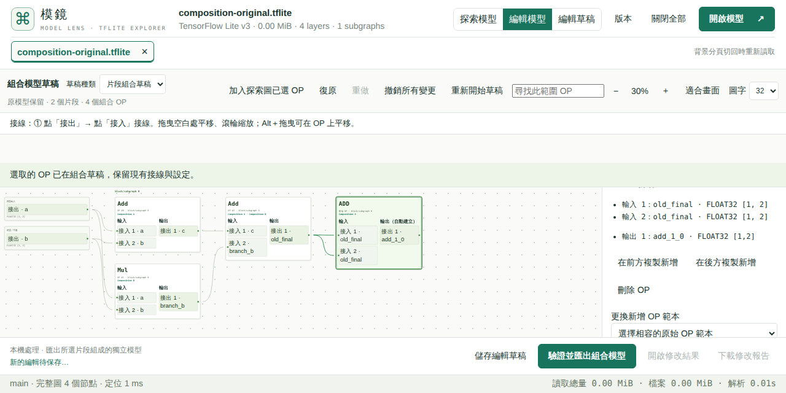

# 選取片段與編輯草稿操作

preview.28 候選將「加入組合草稿」從全站模式切換移到搜尋結果旁，以及圖上圈選工具列。此動作只加入目前匹配或圖上已選 OP。全站仍以探索／編輯兩個工作區切換；編輯區內的「草稿種類」可切換原模型編輯與已建立的片段組合草稿，兩份命令與視角分開保留。

重新進入編輯區會保留草稿。「加入探索圖已選 OP」把探索圖選取補入目前範圍，保留接線。「撤銷所有變更」撤銷命令並保留來源範圍。「重新開始草稿」會先列出目前 OP、命令與重做數，確認後清除這一份工作階段並返回探索；另一種草稿、原模型、已保存的本機備份與下載檔保留。

滑鼠框選只在放開時切換一次：框內原本已選的 OP 取消，未選的加入，框外保持。拖曳途中只預覽；Escape、平移、縮放或重繪取消未完成手勢。SVG 與 Canvas 使用相同切換語意，跨 block 選取及原有 32 OP 上限保留；超限時整次不套用。

編輯圖依 tensor 定義／使用關係分層排列，分支同層並排、匯合接續；節點間距依實際卡片高度計算。這只調整圖形，不變更模型 OP 順序、接線或匯出語意。暫時不合法的循環草稿也會保留可點選的卡片，由既有驗證顯示原因。

本機相關 39 項 Node 測試通過；完整 PR 必要檢查、Hosted 原生滑鼠／32px／重置／接線／草稿與匯出驗收、正式部署仍待取得。沒有本機瀏覽器或手機驗收。Interpreter 使用者回報的錯誤另待完整訊息才能診斷，不列為本次已修復。

## 候選原生驗證

[40831753771](https://github.com/koviankevin/tflite-explorer/actions/runs/40831753771)／來源 `75ac025383e44f0afccad6b462ba5c2772180c16` 的 6 個版本切換與 30 項原生操作均通過。原始 [native ZIP](results/contextual-edit-candidate-native-2026-10-29.zip)、[版本 ZIP](results/contextual-edit-candidate-versioning-2026-10-29.zip) 的 provider digest、CRC、來源與時間在 [獨立收據](results/contextual-edit-candidate-review-2026-10-29.json) 核對；[精確功能斷言](results/contextual-edit-candidate-assertions-2026-10-29.json) 再驗 12 次工作區狀態、真正拖曳取消／重複切換、重置取消／確認、兩種桌面尺寸的 32px 不重疊、兩份匯出 byte ranges、四種示範 CPU 情境，以及 48 模型／10 runtime Workers 關閉。

最終測試維護另將示範回歸沿用至後續 preview 版本，並保留編輯區截圖；不改變應用程式執行或匯出。最終 main 發布關卡與正式交付仍待完成。

## main 正式發布關卡

來源 `ec855a5662be0bd51a142b6f62d200bc14301720`／tree `6257269568780643f4a9a594d183f0e78b0258ca` 與 PR head `cff40b9ac4c99fff21c1716b45672bfe618b0763` 完整 tree 一致；build `d0c4ec54a1e506c0`。main [站台關卡 40832494591](https://github.com/koviankevin/tflite-explorer/actions/runs/40832494591) 的 6 個版本切換、30 項原生操作及新功能 [精確斷言](results/contextual-main-assertions-2026-10-29.json) 通過，完整 [native ZIP](results/contextual-main-native-2026-10-29.zip)、[版本 ZIP](results/contextual-main-versioning-2026-10-29.zip) 與 [獨立收據](results/contextual-main-native-review-2026-10-29.json) 保留。新版示範原始／編輯後 × 全 0／亂數四種 CPU 案例均通過，48 個模型與 10 個 runtime Workers 關閉。

[實體八輪 40832494108](https://github.com/koviankevin/tflite-explorer/actions/runs/40832494108) 的 [獨立收據](results/contextual-main-physical-review-2026-10-29.json)驗證原始 1.25 GiB／21,005 OP、原模型編輯、子模型及組合匯出重開，逐 byte 比對權重與 custom options、pattern 正／負例、草稿與復原／重做，以及程序／Worker 終止與未放寬的記憶體上限。八輪是有限次量測，不宣稱所有長期記憶體問題已排除；本次未跑兩小時或手機驗收。

四關卡的原始 GitHub ZIP、digest／CRC／scope／來源與伺服器狀態由 [獨立四關卡收據](results/contextual-main-gates-review-2026-10-29.json) 核對。核心沿用 40700051621，87 個相依檔與 fingerprint `d25a85aa0caf6999326ea9a4b45298714960c89f9d3146dfe888350f1e4dd01a` 完全相同；其餘本次執行：browser 40832494108、contract 40832491937、site 40832494591。正式準備、發布及固定下載核對尚待完成。
