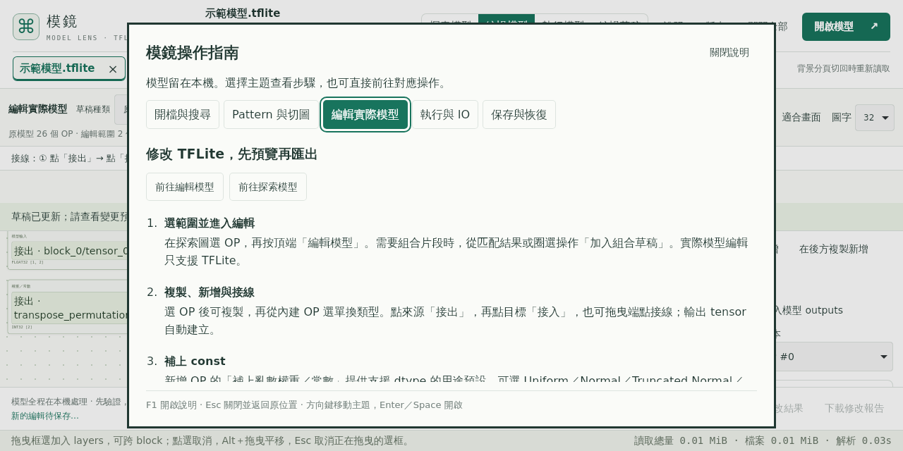
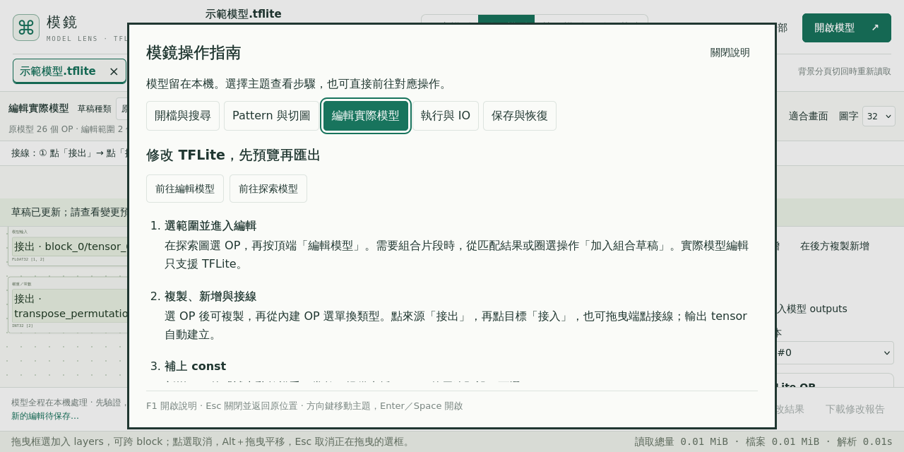

# 現行正式版的跨引擎執行與指南驗收

本輪補齊 Firefox／WebKit 對固定 preview.30 的功能驗收，目標 build `f3ff13b75b83ee57`、site ID `ff1f2e3d7bafb505f8f0bf1037977746625f4c1e4c98e84779bbd301df76d956`。沿用現有 Hosted Linux `desktop-engines.yml`，只擴充測試 driver，不修改應用、workflow、安全設定或固定發布檔，也不重新部署。先前十三項跨引擎歷史結果保留在[桌面驗收](desktop-fixes.md)。

測試重用 Chromium 的原生操作流程：實際 chooser、滑鼠／鍵盤、BIN／草稿／模型下載與重開，以及對實際 CPU／IO bytes 的斷言。DOM 觀察使用既有隔離 selector world，不操作 app API、改 CSP 或啟用網站的 eval。檔案皆為公開合成樣本，網路只允許同源 GET 靜態資源。

新增範圍：

- 正式示範檔的原模型與編輯結果先匯出、重開，再分別使用全 0／亂數執行四次；不以另一個測試 fixture 代替網站示範檔。
- 獨立執行區的十九種情境：原始檔／編輯／組合／子模型、raw 多輸入、四種分佈與 const、實際 CPU／IO ZIP、v3 草稿／Redo／相同 bytes、shape／精度負例、取消／切頁，以及 custom／signature 明確未驗證。
- 五組指南流程：F1／manual tabs／Escape、原生選檔後焦點、忙碌與 MLIR 格式防護、示範新分頁、草稿管理、手動 CPU／IO 及 1280×640／1366×640 的 32px 背景圖。

保留原本十三項探索、pattern、TFLite 接線／權重／custom options／草稿，以及 MLIR SSA／跨 block Canvas／匯出重開的斷言。新流程預期每個引擎合計十六項原生檢查、六十個模型與十六個 runtime Workers 關閉；這些數字是驗收要求；下方已完成的證據逐一核對。舊固定版沒有獨立 Run／指南模組時保留其原有範圍；preview.30 的獨立核對會要求兩個新範圍確實執行，不能以略過代替通過。

前置七項 Hosted 執行界線、chooser／DOM 觀察與 HTTP 身分政策的 Node 檢查已通過。第一輪 WebKit 成功與 Firefox 失敗的 provider ZIP／SHA／CRC、受測來源、固定正式站身分及截圖已核對，詳見下節；後續 Firefox 已完整通過並歸檔，見下方最終核對結果。不把此短流程當成其他 OS、固定硬體 SLA、數小時 interpreter、完整螢幕閱讀器或公司 kernels 驗收。

## 第一輪原生結果與觀察邊界

首次 main 工作流程 `40865708321` 的 WebKit 26.0 job 完成十六項檢查、四次正式示範 CPU、十九種執行情境與五組指南；六十個模型及十六個 runtime Workers 都有原生 close 事件。Firefox 142.0.1 通過原有十三項與正式示範 CPU，但在立即調整至 1280×640 後取樣到 header bottom 128／Run top 115，因此整個 matrix 保持失敗；不能把 WebKit 成功寫成整組成功。

原始 Firefox 截圖中 header 與 Run 已對齊至 128；前一個 1366 寬的瞬間值則為 header 115／Run 128。現有 `resizeInFrame` 明確在 ResizeObserver 後的 animation frame 更新 CSS，因此測試修正為有上限地等待實際幾何位置一致，再保留原本不重疊、無水平溢出及內容高度的斷言，另記錄 initial／settled rectangles。不加固定睡眠、不改應用、不放寬版面門檻；後續只補跑 Firefox，WebKit 原成功結果保留並依相同應用／fixture 與僅觀察等待的差異核對沿用。

獨立讀取器最初沿用 Chromium 的「所有 Worker close」斷言時，也記錄到 WebKit 的最後一個頁面級 Netron layout Worker 沒有 close 通知；前十二個 layout Workers 都已通知關閉，browser close 已完成。跨引擎結果明確區分這個未觀測的最後頁面事件與必須全部通知關閉的六十個模型／十六個 runtime Workers；未知或更多未關閉 Worker 仍拒絕。這不是所有程序／RSS 的驗收，不將未觀測事件當成已證實關閉。原始 provider ZIP／SHA／CRC 與這項讀取器失敗會保留。

Firefox 補跑 `40867450185` 已通過十九種 runtime 情境，initial／settled rectangles 也確認 1366 與 1280 都在排版完成後對齊；最後指南的忙碌測試則因「abort WASM 請求一定使執行失敗」的假設而失敗。原始網路紀錄確有 abort，但本次執行仍回報成功；session 每次開始會清掉舊 validation，不能將它解讀為舊結果殘留，也沒有足夠 trace 指定是哪一種快取／fallback 路徑。測試改成先暫停真實 WASM 請求，確認導覽停用，再放行並要求 CPU 成功、指南仍開啟且導覽恢復；原本的忙碌防護與草稿保留斷言仍在。這是跨引擎測試完成條件的修正，不修改應用，原失敗保留；後續仍只補跑 Firefox。

## 最終核對結果

[合併獨立核對](results/desktop30-combined-review-2026-10-29.json)實際 exit 0 後才寫入本批證據。兩引擎目標均是既有正式 preview.30／build `f3ff13b75b83ee57`，核心來源 `0ee55ba2803038b22b0c11dfc38b6f890aedca5c`，全站 1,400 檔及固定 site ID 均由相同 HTTP 驗證器核對；本輪不修改應用、依賴、workflow 或重新部署。

| 引擎 | 成功來源與 job | 已核對的範圍 |
| --- | --- | --- |
| webkit 26.0 | [40865708321 / 123419840628](https://github.com/koviankevin/tflite-explorer/actions/runs/40865708321/job/123419840628)，driver `eef235153d9a732d61f4d2ac1651cbd00a30b137` | 16 項原生操作、4 次正式示範 CPU、19 種執行／分佈情境、5 組指南；60 個模型及 16 個 runtime Workers 原生 close |
| firefox 142.0.1 | [40868692321 / 123429890364](https://github.com/koviankevin/tflite-explorer/actions/runs/40868692321/job/123429890364)，driver `a9dcc78ea48e8dec0b6dd6c25565dcafddde2f0f` | 16 項原生操作、4 次正式示範 CPU、19 種執行／分佈情境、5 組指南；60 個模型及 16 個 runtime Workers 原生 close |

十九種情境核對 raw 多輸入、實際 ADD／MUL／CONCATENATION outputs、四種 const／input 分佈及 seed、v3 草稿／Redo／相同 bytes 重匯出、編輯／組合／切圖重開後才執行、型別／shape／整數精度負例、取消／換頁，以及 custom／signature 明確未驗證。原有 pattern、TFLite IF／WHILE／opaque options／權重、MLIR SSA／跨 block Canvas／分支／匯合／迴圈與匯出重開保持通過。兩種筆電邏輯尺寸及 32px 背景圖、F1／manual tabs／Escape、選檔後焦點、忙碌導覽與草稿／視角保留也通過。

Firefox [40868692321](https://github.com/koviankevin/tflite-explorer/actions/runs/40868692321)為單引擎成功 run。WebKit 沿用首次 matrix 的成功 job，原 matrix 內的 Firefox 失敗仍保留，沒有把整個 run 改寫為成功；[初次矩陣認證](results/desktop30-initial-matrix-review-2026-10-29.json)、[Firefox 指南失敗認證](results/desktop30-firefox-guide-red-review-2026-10-29.json)與[最終 Firefox 認證](results/desktop30-firefox-final-review-2026-10-29.json)分別保存。

合併核對同時比較兩個 driver 與固定應用的全部 src／vendor／scripts／package／workflow blobs，皆相同；兩次補跑只改 runtime 排版等待、guide 的請求完成策略與說明。Fixture、runtime 演算法、十九種功能斷言與公開應用沒有改動，因此沿用已成功的 WebKit，而不重跑相同功能。新 Firefox 的 initial／settled rectangles 證實 1366 與 1280 都等到實際對齊；指南另有明確 busyCompletion：停用、CPU passed、指南仍開啟、重新啟用與草稿不變。

原始 [WebKit ZIP](results/desktop30-webkit-original-2026-10-29.zip)、[Firefox 排版 red ZIP](results/desktop30-firefox-layout-red-2026-10-29.zip)、[Firefox 指南 red ZIP](results/desktop30-firefox-guide-red-2026-10-29.zip)、[最終 Firefox ZIP](results/desktop30-firefox-final-2026-10-29.zip)及[原始 artifact 對照](results/desktop30-original-artifacts-2026-10-29.json)保留；provider digest／CRC／來源／attempt／時段、原始報告及截圖 bytes 均核對。[獨立斷言文字](results/desktop30-assertions-2026-10-29.mjs.txt)與[合併程式文字](results/desktop30-combine-producer-2026-10-29.mjs.txt)供稽核；若要重播，需放回原 build/qa 位置以解析相對 imports，並使用對應 driver／固定發布來源及原始檔案路徑，不是可任意環境直接執行的一鍵工具。

### 觀察界線

兩引擎各有一個最後頁面級 Netron layout Worker 的 shutdown close 事件未觀測；前面的 layout Workers 與全部模型／runtime Workers 已通知關閉，browser close 已完成。此結果不宣稱所有 OS 程序或 RSS 已驗收。Firefox 的 runtime page request 事件只觀察到十次 WASM fetch，未觀測到 loader JS module 事件；WebKit 則有十次各三種 loader JS 與 WASM，共四十次。所有已觀測 request 都符合固定版本的同源 GET；Firefox 的缺少事件不當成零次載入，也不宣稱完整 JS 載入網路 trace。靜態全站 HTTP 身分／bytes 的獨立核對保持原範圍。

這是 Hosted Linux 上指定兩引擎的功能相容性結果，不代替其他 OS、固定硬體 SLA、數小時 runtime／組合負載、連續 Worker heap 峰值、真人易用性、完整螢幕閱讀器或公司環境驗收。整體商品等級目標仍在進行。
