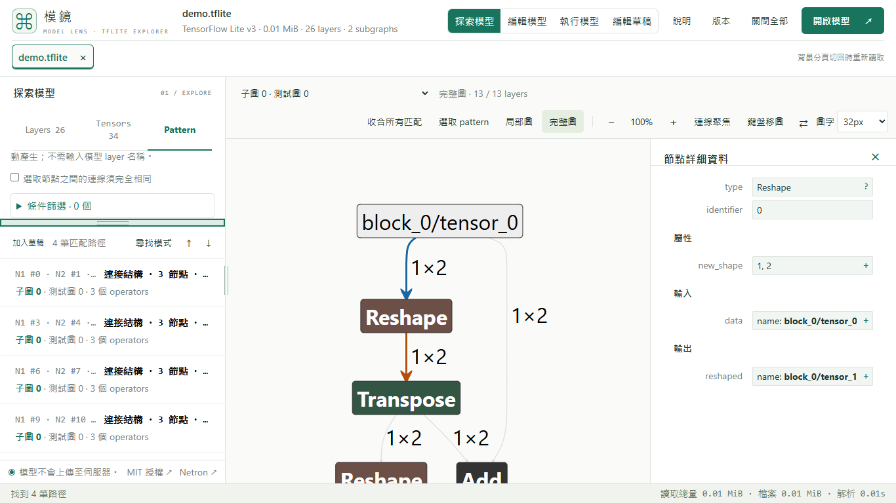
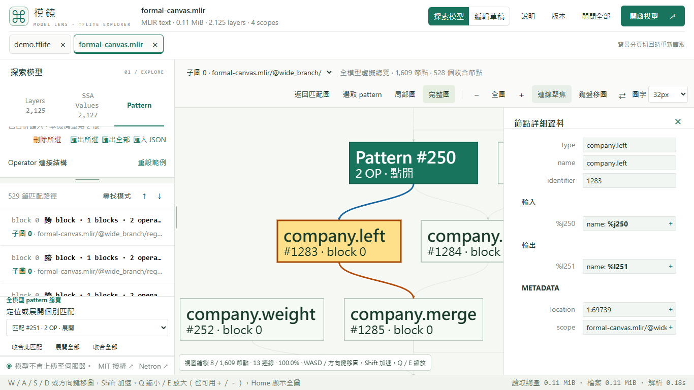

# Pattern 高度分配與連線聚焦

v1.7.0 已於 2026-11-03 11:53:32（台灣時間）完成正式交付；正式站與固定下載使用相同來源及產物。

Pattern 分頁把搜尋設定、分隔線和搜尋結果分成三列。拖曳中只改左欄的高度分配，不重畫模型；設定與結果各自捲動。結果標題保留固定搜尋按鈕，「加入草稿」仍只操作目前片段。結果附加的 blocks、分段路徑與總覽控制在另一個有限高的捲動區，避免取代整個結果清單。

分隔線使用原生 pointer capture、每 frame 合併更新與 ResizeObserver；不依模型開關新增監聽。↑／↓ 調整 10px，Shift 調整 40px，Home／End 到上下限，Enter／雙擊重設；拖曳時 Escape 還原。只在此瀏覽器記住比例，換分頁、關閉或重開模型不清除；視窗縮小會暫時限制兩區高度，保留偏好比例。儲存被停用時仍可拖曳。

選取 OP 或一組匹配時，SVG／Canvas 可聚焦直接相關的連線：藍色輸入、橘色輸出、紫色內部或迴圈；其他線淡化，高亮加上白色襯線並在背景線之後繪製。虛線繼續代表控制流程。「連線聚焦」按鈕可恢復完整連線。tensor 詳情沿用原有 tensor 選取。OP 縮小後沿用滑鼠完整名稱提示。

每份顯示圖只建立一次 incident-edge 索引。切換所選 OP 的工作量取決於相關邊數，不遞迴遍歷控制路徑；Canvas 每 frame 仍只畫空間索引查到的可見邊。切換顏色不呼叫定位或 layout、不修改模型或圈選集合。SVG 的襯線與箭頭在重畫／關閉時移除，Canvas 的索引隨 controller 釋放。

本機初測：獨立安裝版 Chrome／Edge，以 1366×768、1280×640 CSS 可用畫面和 32px 圖字操作。實際測拖曳、鍵盤與獨立捲動、分頁與重開後恢復，以及 2,125 OP Canvas 收合／展開後切換聚焦不改視角。未宣稱使用實體 14 吋面板；私人模型、手機與其他瀏覽器不在本次範圍。

正式 HTTPS 驗收沿用原本 38 項檢查，從 v1.7.0 起增加 separator 操作、SVG／Canvas 聚焦與反覆切換襯線數目檢查；仍測跨 block 分支／迴圈的 pattern 與 MLIR 匯出重開，以及 TFLite 的 pattern／子模型匯出。必要關卡與限制不變。

## v1.7.0 正式交付

[發布工作流程](https://github.com/koviankevin/tflite-explorer/actions/runs/41573974437) attempt 1 的 prepare、deploy、verify_live、release 均成功。來源 `7009b1f7faebf7f50360106c3e25e5632230af48`，tree `27d69ffeab90c133977be15ab506a155fe2a11fe`，build `1353dd74a9b8b6b7`，site ID `07d53c2367d6ece2b9a7bc7afcb1944b5041258a3e13370c616e12abb70e5ce2`。336 核心檔、全站 1,498 檔逐一核對，四份實際固定下載與 Latest／tag／deployment 相符；[交付收據](results/graph-readability-v1.7.0-published.json)保留精確雜湊與 provider／log 綁定。

候選第一次網站驗收在 Canvas 圈選後縮回全圖，找不到原匹配的鍵盤控制；[原始 run](https://github.com/koviankevin/tflite-explorer/actions/runs/41570277109)、[原始 artifact](results/graph-readability-initial-site.zip)與 provider SHA-256 `037ea0474ac6efb62de549fe81fc1f7b1317c7fc8a526b0ae100d51d82d183dd`保留。#252 將連線焦點與匹配控制分離，新增 1,601 OP 回歸案例；修正來源完整通過原有 38 項檢查，沒有減少案例或放寬政策。未發布失敗來源。

正式 Chrome／Edge 使用實際選檔，驗證 1366×768、1280×640 與 32px：分隔拖曳、取消、重設、兩區捲動、分頁／重新載入比例、SVG／2,125 OP Canvas 聚焦、反覆切換襯線不累積、圈選與 Home／WASD／Q／E 後保留匹配控制。HTTPS 原有案例另確認跨 block 分支／迴圈 pattern、SSA 和 MLIR 匯出重開，以及 TFLite pattern／子模型匯出重開。

必要大模型關卡於來源 `31901277152c88ba34e38daf9b1d1a873b7ac66a`完成真實 1,349,965,216-byte／21,005 OP TFLite 八輪，不強制 GC；核心效能依相同指紋沿用。固定站保留上一版 v1.6.1 `20714da852db2604`、v1.6.0 `bd4c7fe66904b362`及永久 legacy namespace。其他商品化工作暫停，僅發布 GitHub，未同步 Sites。發布後文件更新不重跑部署。

原生 Edge 首次載入紀錄含 503，當時未記錄失敗網址，因此未判定根因。只補測獨立 Edge 一次，新增的回應觀察無 HTTP 失敗、全部操作通過；沒有重跑工作流程或部署。兩端本機防毒注入的外部請求均被阻擋，功能驗收與乾淨 CI 結果分開記錄，原始診斷保留於本機，公開收據不包含防毒 session IDs／query strings。
