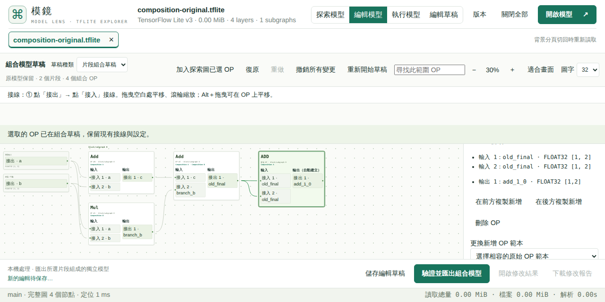

# 探索、編輯與執行工作區

這是 preview.29 開發中的操作契約，尚未代表正式站已更新。正式發布與驗收證據會另外記錄。

探索負責搜尋、pattern 與切圖；編輯負責草稿、接線及結構／資料完整性驗證；「執行模型」只使用目前網站內模型分頁已開啟的不可變 TFLite 檔。執行區不接收編輯命令，也不建立草稿候選。

局部執行流程為：圈選 OP → 匯出 TFLite 子模型 → 開啟匯出結果 → 執行模型。編輯／組合草稿同樣必須先驗證匯出並開啟結果。選取 OP、搜尋匹配、目前顯示的 subgraph 或尚未匯出的草稿都不會改變執行目標。入口仍是模型主 subgraph 與實際走到的控制流程，並非逐一執行所有 subgraphs。

執行區顯示目前檔名及可支援的 input／output 規格。手動選擇各個 input 的 raw `.bin`、全 0 或依 dtype 的亂數，再執行一次。載入執行區只讀取已解析的介面，不載入 WASM 或讀取完整權重。模型、BIN 與 IO 都留在本機。

亂數輸入與編輯 const 共用 [資料規則與合理預設](tensor-random-distributions.md)，包含 Uniform、Normal、Truncated Normal、Bernoulli 與可展開的進階參數。

輸入大小／型別檢查、30 秒取消／逾時、CPU WASM 與 [執行資源上限](tflite-runtime.md)沿用現有策略。custom kernels、動態型別及資源超限仍明確標示未能驗證，不當成通過。執行成功不證明精度、所有控制路徑或與原模型等價。

編輯匯出報告只記錄結構及資料完整性，runtime 項目維持未執行。執行結果與實際 inputs／outputs 另存 IO ZIP，manifest 的模型 SHA-256 對應目前開啟的檔案。兩份報告分開，避免把原模型的成功套到後續草稿。

新一次執行先清除舊 IO；換模型分頁或關閉時取消工作並釋放 IO、介面快取與 Worker。背景分頁只保留工作區位置，不保留執行結果或 Worker。切換同一模型的探索／編輯／執行區可保留已完成的 IO；離開執行區會取消尚在進行的工作。舊 async 回應必須同時符合來源 File 身分及執行 generation 才能更新畫面。

驗收包含實際原模型、編輯／組合匯出重開及切圖匯出重開；以 IO manifest 核對實際輸入模型 bytes，並檢查 BIN 多輸入、dtype 安全亂數、取消／焦點、關閉／分頁、custom／signature 排除、32px 編輯視角與 1280×640／1366×640 桌面版面。瀏覽器驗收只在 Hosted CI 執行。

## 匯出後 builtin options 診斷

有效 ADD 子模型曾在正確計算 `[4,6]` 的同時，因原本不存在的 `custom_options` 被重新寫成長度 0 的向量而收到 LiteRT `Found builtin operator ADD with custom options` 診斷。[修正前 regression](results/runtime29-builtin-options-red.json)與[單一變因隔離](results/runtime29-builtin-options-isolation.json)保留；修正只省略已知 builtin OP 的空 custom options，不過濾 runtime 訊息，也不移除實際 custom bytes 或 external options。

[1.25 GiB／21,005 OP 獨立序列化比對](results/runtime29-physical-writer-oracle.json)在 clean `3796310` 執行，四項舊 SHA 均以凍結 writer 重現，修改後與僅將 builtin 空 options 正規化的獨立輸出一致；來源 payload ranges、權重及 custom options 保留。完整編輯與組合 SHA 不變，兩個子模型 SHA 因修正向量欄位而更新。最初將子模型切自原檔而非完整編輯結果的 lineage 不符仍記錄為失敗；修正測試來源後的 continuation 實際 exit 0，沒有改低門檻或改寫舊證據。這是有限合成 bytes 證據，並非公司 kernel 或所有模型相容性保證。

## main 與 Hosted 驗收

來源 `e9689bc0cd2f2c46525ef47db0db5baca02594e7`／tree `d8676d76bcd91600e2557e2d2a02e2cd260b05be` 與 PR #117 最終受測 tree 相同，build `f114327186463f60`。main [站台關卡 40847098088](https://github.com/koviankevin/tflite-explorer/actions/runs/40847098088) 與 [原生 ZIP](results/runtime29-main-native-2026-10-29.zip)、[版本切換 ZIP](results/runtime29-main-versioning-2026-10-29.zip)、[獨立核對](results/runtime29-main-native-review-2026-10-29.json)保留；[精確斷言](results/runtime29-main-assertions-2026-10-29.json)驗 30 項原生操作、19 種執行情境、68 個模型及 14 個 runtime Workers 全部關閉。原模型、編輯與組合結果、實際切圖都走開啟後才執行的流程，IO 以真實匯出 SHA 核對；匯出報告保持未執行。

四種亂數共用預設、實際 const／input bytes 與 CPU outputs、v3 草稿匯入／Redo／32px 視角／再次匯出相同 bytes 均通過。Node CI 40846038129 曾因新控制項缺少測試 DOM 工廠及舊預設期望而失敗，保留 [CI 原始輸出](results/runtime29-node-ci-red-2026-10-29.log)與[本機 red](results/runtime29-inspector-unit-red-2026-10-29.log)；修正後 48 項相關 Node 與最終 PR [Node／建置 40846766245](https://github.com/koviankevin/tflite-explorer/actions/runs/40846766245)成功，未將原失敗改寫為通過。

[1.25 GiB／21,005 OP 八輪 40847076914](https://github.com/koviankevin/tflite-explorer/actions/runs/40847076914)的 [原始 ZIP](results/runtime29-main-physical-2026-10-29.zip)及[獨立核對](results/runtime29-main-physical-review-2026-10-29.json)通過原有門檻：兩輪暖機後 RSS 漂移 9,973,760 bytes，斜率約 770,282 bytes／輪，main heap 漂移 234,964 bytes，取樣峰值 1,004,158,976 bytes；40 個模型／16 個指紋 Workers 關閉，6 個觀察到的 PID／start-ticks 身分正常退出，無強制清理。權重、opaque custom options、固定 SHA、pattern 正負例及匯出重開保持正確。有限八輪不代表所有模型或長期記憶體狀況均已驗證；本次未跑兩小時或手機。

[四關卡獨立收據](results/runtime29-main-gates-review-2026-10-29.json)驗 provider digest／CRC、run／來源、原始數值與依賴 scope；本次 main core 40847067607、browser 40847076914、contract 40847087035、site 40847098088 均成功。全部嚴格讀取器實際 exit 0 後才寫入此批證據；正式準備、發布與固定下載驗證尚待完成。歷史 writer [產製程式](results/runtime29-writer-oracle-producer-2026-10-29.mjs.txt)、[continuation](results/runtime29-writer-oracle-resume-2026-10-29.mjs.txt)、[計畫](results/runtime29-writer-oracle-plan-2026-10-29.json)、[append-only 事件](results/runtime29-writer-oracle-events-2026-10-29.jsonl)與[來源說明](results/runtime29-writer-producer-provenance-2026-10-29.json)保留，未將超過 1 GiB 模型加入 repository。
