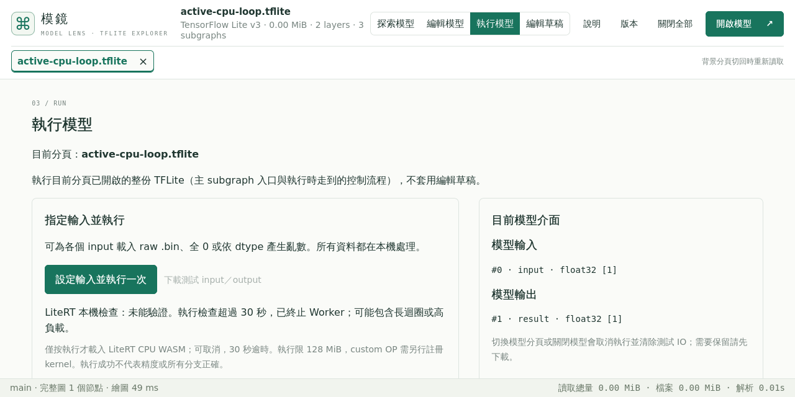

# 真實 CPU 運算中的取消與逾時驗收

現有 native 取消案例暫停同源 WASM 下載，30 秒 deadline 則有 mock-timer 單元案例。這些結果不能證明 kernel 已開始計算時，主頁仍可操作、Worker 能被取消／逾時終止，或之後仍可正常執行。因此本輪補一組實際運算驗收，不修改應用、timeout、workflow 或固定 preview.30，也不重新部署或跑兩小時負載。

使用公開合成 TFLite：主 graph 有 WHILE，condition graph 回傳常數 BOOL，body 以 ADD 將狀態加一。false／true 兩份檔案只差一個 boolean byte，shape、dtype、options、介面及 graph 都相同；不以 malformed／custom／動態模型假裝 kernel 忙碌。false 版本已在有外部 15 秒程序上限的 Node 子程序，以真正 CPU WASM 驗證 raw input `7` → output `7`；true 版本在本機只解析及核對 byte，不在無外部 guard 的程序執行。

Hosted 流程只用真實 chooser、鍵盤、按鈕、下載及 read-only DOM：

1. 開 false 模型，以 raw `.bin` 執行成功，下載 ZIP 核對模型 SHA 與 output `7`。
2. 開 true 模型，等網站回報已進入「使用指定測試輸入執行」階段；沒有 route hold／fake timer。此時用 F1 開說明再關閉，確認 Worker 仍活著、Run 仍忙碌、UI 可在五秒內回應，再原生點取消，要求五秒內收到 close、顯示未驗證及取消原因、不提供舊 IO。
3. 對同一 true 模型重新執行，確認已進入 invoke，等待網站自己的 30 秒 timer。必須顯示未驗證／超過 30 秒並終止 Worker，不能誤判 passed；原生觀測的 Worker 壽命要求 25～40 秒，保留實際值而不把排程延遲當成精確硬即時保證。測試另有 45 秒觀察上限。
4. 關閉後重新開 false 模型，再以同一 raw input 得到 `7`，核對新 IO ZIP／模型 SHA，證明取消與逾時後仍可恢復操作。

新流程增加三個模型 Workers、四個 runtime Workers，實際全部收到 close。每個引擎四組子情境；Chromium 原生檢查由 31 增至 32、模型由 71 增至 74、runtime 由 16 增至 20；Firefox／WebKit 各 17 項檢查、63 模型／20 runtime Workers，已由下列原始資料核對。

只在既有 Hosted Linux 工作流程，以同一固定 preview.30／build `f3ff13b75b83ee57` 實測。只有獨立 Run 及指南模組皆存在的版本啟用新流程，較早固定版本保留原有覆蓋。原十九種 runtime、CPU／IO、分佈／const、草稿、pattern、TFLite／MLIR 匯出重開及指南驗收都保留。

## 三引擎實際結果

[合併獨立核對](results/active-compute30-combined-review.json)實際 exit 0 後才寫入本批證據。Chromium 使用 PR #127 branch driver `b406b6bfc5330d7e5153a2d96b3f01a09de556a9`，Firefox／WebKit 使用合併後 main `dd882315cee069484af80d64bed5f33829a0a40e`；完整 Git tree 均為 `549a3624bfa2b58e2d91ad1b78b64e0463a7b8cc`。三個 driver 的應用、依賴、建置及 workflow blobs 與固定正式來源 `0ee55ba2803038b22b0c11dfc38b6f890aedca5c` 相同；沿用成功的 Chromium，沒有重跑成功測試或部署。

| 引擎／工作流程 | 運算中 F1 回應 | 取消至 close 事件 | 逾時 Worker 觀測壽命 | 取消／逾時後恢復 |
| --- | --- | --- | --- | --- |
| [Chromium 40873286083](https://github.com/koviankevin/tflite-explorer/actions/runs/40873286083) | 22 ms | 2,043 ms | 31,990 ms | CPU output `7`，IO 模型 SHA 正確 |
| [Firefox 40874474215](https://github.com/koviankevin/tflite-explorer/actions/runs/40874474215) | 16 ms | 66 ms | 30,018 ms | CPU output `7`，IO 模型 SHA 正確 |
| [WebKit 40874474215](https://github.com/koviankevin/tflite-explorer/actions/runs/40874474215) | 54 ms | 38 ms | 29,985 ms | CPU output `7`，IO 模型 SHA 正確 |

這些是單輪原生 UI／Worker 事件的 wall time，包含瀏覽器與協定的排程延遲，不是 CPU 持續運算時間或硬即時 SLA。網站 timer 仍為 30 秒。三引擎都在實際 invoke 階段取消／逾時，結果明確為未驗證、IO 停用；重新開啟正常模型後可執行及下載新 IO。三個新增模型及四個新增 runtime Workers 各自全部收到 close。完整既有功能也通過：Chromium 32 項、74 模型／20 runtime；Firefox／WebKit 各 17 項、63 模型／20 runtime，全部專用模型及 runtime Workers 都有 close 事件。

兩份 fixture 均為 2,300 bytes，只差一個 BOOL byte；false SHA `6c9da012fb3dfc9d9cfae2d6bb7b2699e501dad1c1a7c4d507ab2920cba31bad`，true SHA `e24ec3ce32ef0f49ddc49ac1ac630d68185dcb0d5ffb7ca8de9c840198cafe77`。核對包含 provider digest、ZIP CRC、run／job／attempt／來源／時段、原始報告、截圖、實際模型 SHA 與 CPU output。保留 [Chromium 原始 ZIP](results/active-compute30-chromium-original.zip)、[Firefox 原始 ZIP](results/active-compute30-firefox-original.zip)、[WebKit 原始 ZIP](results/active-compute30-webkit-original.zip)、[Chromium 獨立收據](results/active-compute30-chromium-review.json)、[兩桌面引擎收據](results/active-compute30-desktop-review.json)與[完整檔案／程式 SHA 清單](results/active-compute30-archive.json)。

合併讀取器最初誤將 Chromium 的原始報告當成桌面引擎 schema，因缺少 `source` 而 exit 1；改用其既有 `driverSourceCommit`／`siteRelease` 欄位後，所有來源、固定版本、bytes、事件與功能斷言仍需通過。此讀取器失敗記錄在歸檔清單，沒有改低瀏覽器門檻或重跑流程。獨立程式為稽核文字，需按原 build/qa 路徑與 imports／來源復原才能重播。

這組有界測試不等於所有長迴圈、背景分頁節流、所有模型／OS、數小時 interpreter、完整 RSS／持續 heap 峰值或 custom kernels 驗收。既有跨引擎頁面 layout Worker 與 network 事件的[觀察界線](desktop-runtime.md#觀察界線)也不改寫。
