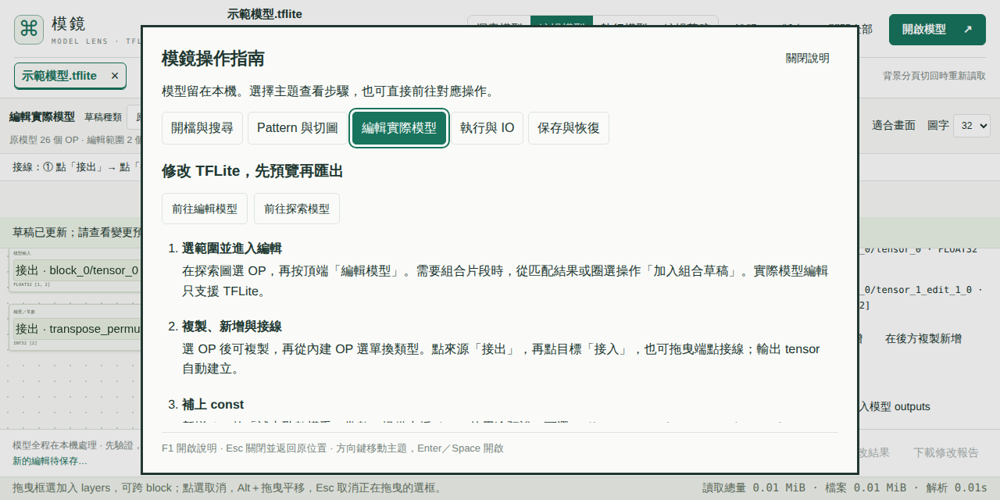

# 網站內操作指南

Preview.30 候選增加頂端「說明」、歡迎畫面的第一次使用入口及 F1。五個主題分別說明開檔／搜尋、pattern／切圖、實際模型編輯、執行／IO 與保存／恢復；名稱對應目前可見控制項，不再指向已移除的舊 interpreter 按鈕。

指南預設開啟目前工作區的主題。閱讀、切換說明或關閉不會修改選取、搜尋、草稿、模型或已完成的 IO；操作按鈕需由使用者明確選擇，關閉說明後才前往相應功能。示範模型開在新的模型分頁，原模型保留。前往執行工作區只讀取介面，必須再指定 input 並手動執行。

無模型或 MLIR 不支援的操作會停用並顯示原因；背景操作進行中暫停導覽，完成後在同一份說明更新可用狀態。只在指南開啟期間觀察六個固定狀態元素的 `aria-busy`／`hidden`，不掃描模型圖的 child nodes，也不使用輪詢 timer。RPC 起訖只在指南開啟時更新動作；說明關閉即移除觀察。

主題分頁用方向鍵移動，Enter／Space 才切換內容；Tab／Shift+Tab 保持在 modal 內，Escape 關閉並返回原先焦點。指南內部捲動，頂端關閉與主題入口保留；開啟新主題從說明頂端開始。背景圖的 32px、縮放、選取與編輯歷史不因閱讀指南而重設。

驗收選測涵蓋無模型、TFLite／MLIR 導覽界線、忙碌狀態、F1／manual tabs／焦點、實際本機選檔、示範新分頁、32px／1280×640 與 1366×640、草稿管理、手動 CPU／IO，以及背景執行結束時在開啟的指南更新按鈕。瀏覽器只在 Hosted CI 操作公開合成模型；未將此流程當成真人易用性或完整螢幕閱讀器驗收。正式發布與結果仍待候選驗證。

## main 與 Hosted 驗收

來源 `df849a2e851536fb67955ebaaff99c20ba63e15c`／tree `f50da3bd550f6a5e58df8723212d82cdce482b80` 與 PR #120 最終候選受測 tree 相同，build `89e0710a4bcf98bb`。[main 站台關卡 40859657744](https://github.com/koviankevin/tflite-explorer/actions/runs/40859657744) 的 [原始原生 ZIP](results/guide30-main-native-2026-10-29.zip)、[版本切換 ZIP](results/guide30-main-versioning-2026-10-29.zip)、[獨立核對](results/guide30-main-native-review-2026-10-29.json)及[嚴格斷言](results/guide30-main-assertions-2026-10-29.json)保留；31 項原生操作、19 種執行／分佈情境、五組指南流程通過，71 個模型與 16 個 runtime Workers 全部關閉。

指南實測包括 F1／manual tabs／Escape 焦點、真實本機 MLIR 選檔與格式防護、示範模型新分頁、草稿管理、手動執行及實際 IO 模型 SHA、忙碌狀態自動更新，以及 1280×640／1366×640 的 32px 背景圖。閱讀說明保留選取、草稿命令和縮放；導覽到執行區不啟動 interpreter。原本的 pattern、SSA／控制流程、custom options、草稿及 TFLite／MLIR 匯出重開均維持既有驗收。

### 原生焦點與非同步導覽的修正

首次候選 [40856894302](https://github.com/koviankevin/tflite-explorer/actions/runs/40856894302) 與診斷候選 [40857648968](https://github.com/koviankevin/tflite-explorer/actions/runs/40857648968) 發現：原生選檔後焦點在 body，Escape 關閉說明時焦點仍停在已關閉的主題分頁，下一次 F1 被 modal 的鍵盤處理攔下。只等待關閉沒有修好此問題。現在 showModal 前先將 body／不可見／已關閉指南的焦點轉至可見「說明」按鈕，F1 在 capture 階段處理；其他已開啟 modal 仍維持自己的鍵盤範圍。

[40858401237](https://github.com/koviankevin/tflite-explorer/actions/runs/40858401237) 確認焦點修正通過，但最後的示範下載尚未完成時，測試便將舊模型的 ready 狀態當成新模型完成。驗收改為等待精確的新分頁數與檔名，再核對原有 ready 條件，沒有移除斷言或改動應用模型流程。原始失敗 [ZIP 1](results/guide30-red-40856894302-2026-10-29.zip)、[ZIP 2](results/guide30-red-40857648968-2026-10-29.zip)、[ZIP 3](results/guide30-red-40858401237-2026-10-29.zip)及[認證與焦點紀錄](results/guide30-native-failures-2026-10-29.json)保留。最終[候選 40858995013](https://github.com/koviankevin/tflite-explorer/actions/runs/40858995013)及 main 均完整通過；[候選獨立核對](results/guide30-candidate-native-review-2026-10-29.json)與[原始 ZIP](results/guide30-candidate-native-2026-10-29.zip)未改寫前述失敗。

### 發布關卡與效能界線

[實體 1.25 GiB／21,005 OP 八輪 40859648810](https://github.com/koviankevin/tflite-explorer/actions/runs/40859648810) 的[原始 ZIP](results/guide30-main-physical-2026-10-29.zip)與[獨立核對](results/guide30-main-physical-review-2026-10-29.json)通過既有 policy，權重、opaque custom options、固定 SHA、pattern 正負例、完整／局部匯出重開、模型及指紋 Workers 與觀察到的 PID／start-ticks 釋放均通過，無強制 GC 或程序清理。

[四關卡收據](results/guide30-main-gates-review-2026-10-29.json)核對 provider digest／CRC、原始數據、run／job 與依賴來源。核心 40847067607 的 87 檔指紋與本版相同，沿用該次成功結果；browser 40859648810、contract 40859653330、site 40859657744 使用本次 main 的成功結果。全部嚴格本機讀取器實際 exit 0 後才寫入此證據。正式發布與固定下載仍待後續核對。

有限八輪與合成原生操作不代表所有模型、其他 OS／引擎或數小時 interpreter 皆無問題；五主題自動流程也不代替真人新手易用性與完整螢幕閱讀器驗收。其餘範圍保留在[品質清單](product-readiness.md)。
